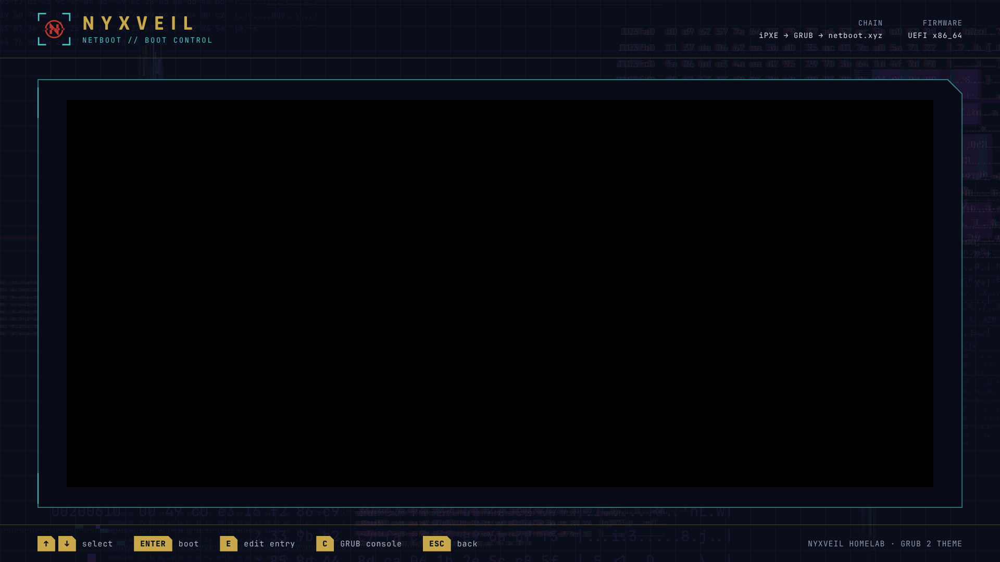
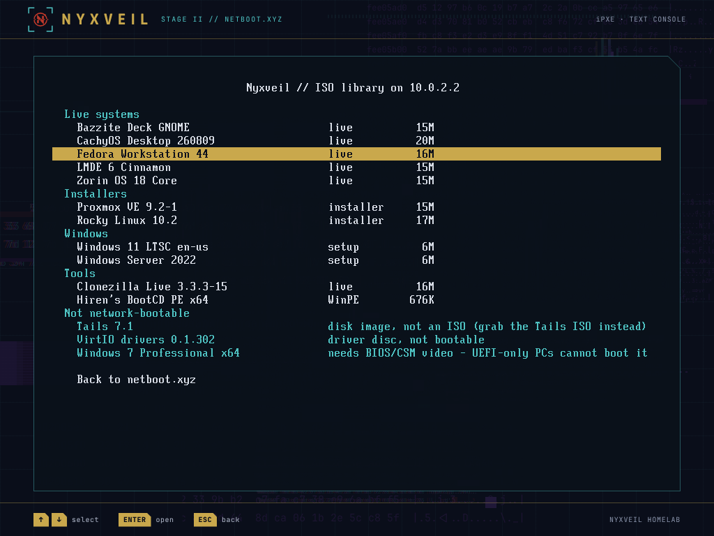
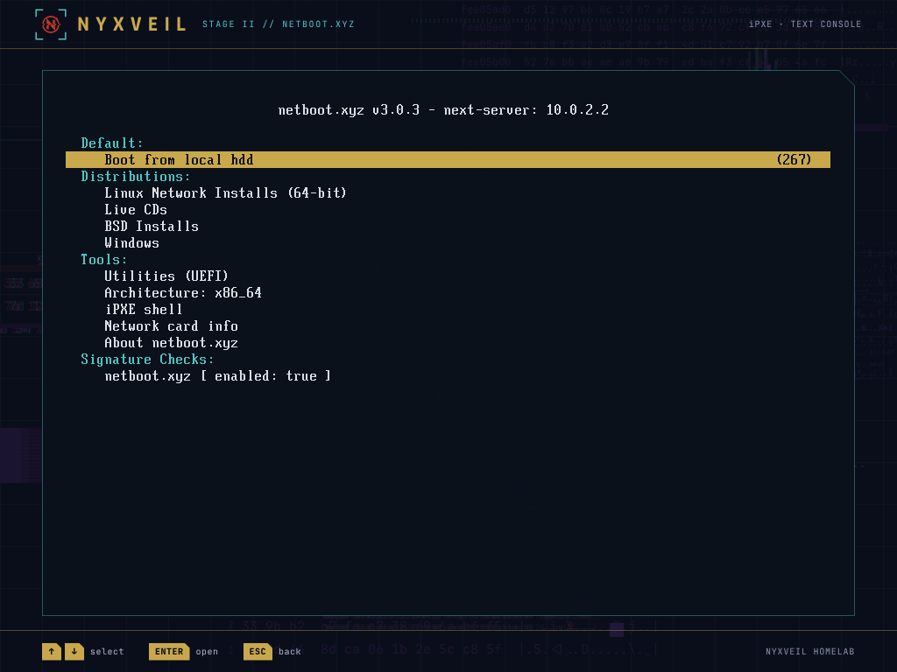

# Nyxveil netboot

[netboot.xyz](https://netboot.xyz) in one container, plus two things on top:

- **A themed boot experience.** It adds a GRUB front menu (netboot.xyz menu, **ISOs**, Boot local disk, UEFI firmware setup, Reboot, Power off) and restyles netboot.xyz's own menus to match.
- **A drag-and-drop ISO library.** Copy an ISO into a folder and, once the copy finishes, it shows up under **ISOs** and is bootable over the network. Delete it and it disappears.

| GRUB front menu | ISO library | netboot.xyz menu |
| --- | --- | --- |
|  |  |  |

The image is built on the official `netbootxyz/netbootxyz` image. Everything netboot.xyz does (TFTP, the web UI on port 3000, `/config`, `/assets`) works exactly as upstream documents it.

## Quick start

```bash
mkdir nyxveil && cd nyxveil
curl -O https://raw.githubusercontent.com/wolfik958/nyxveil-netboot/main/compose.yaml
# edit the ISO path in compose.yaml, then:
docker compose up -d
```

Or as a single command:

```bash
docker run -d --name nyxveil-netboot --restart unless-stopped \
  -p 3000:3000 -p 69:69/udp -p 80:80 \
  -v ./config:/config -v /path/to/isos:/assets/iso:ro -v ./nyxveil:/assets/nyxveil \
  ghcr.io/wolfik958/nyxveil-netboot:latest
```

Then point PXE clients at this host from your DHCP server:

- **Next server / TFTP server:** the IP of the Docker host.
- **UEFI x86_64 clients:** boot file `netboot.xyz-snp.efi`. `netboot.xyz.efi` also works, but it can lose the USB keyboard on some PCs.
- **Legacy BIOS clients:** `netboot.xyz.kpxe`. These get stock netboot.xyz plus the ISO library under **Custom URL Menu**.

If both BIOS and UEFI machines boot from the same network, the DHCP server has to choose the file per client, from the architecture each client reports in option 93. [docs/dhcp.md](docs/dhcp.md) has example configurations for MikroTik RouterOS and Cisco IOS. They're examples only: other devices and software versions configure this differently.

Secure Boot must be off on the clients. The GRUB front menu is unsigned.

## How the ISO library works

A watcher inside the container checks `/assets/iso` every 5 seconds:

1. **While an ISO is still being copied,** the menu lists it under **Arriving**.
2. **Once the file has stopped changing for 30 seconds,** the watcher reads the ISO directly (it never mounts it). It copies the few files a network boot needs into `/assets/nyxveil` and rewrites the menu.
3. **When an ISO is deleted,** its files and its menu entry are removed.

Supported ISOs and how they boot:

| ISO family | Examples | Method |
| --- | --- | --- |
| dracut live | Fedora, Nobara, Bazzite | `root=live:<ISO URL>`; the ISO is loaded into RAM |
| casper | Ubuntu, Zorin, Pop!_OS | `url=<ISO URL>`; the ISO is loaded into RAM |
| live-boot | Debian live, LMDE, Clonezilla, GParted | `fetch=<ISO URL>`; the ISO is loaded into RAM |
| archiso | Arch, CachyOS, EndeavourOS | `archiso_http_srv`; only the root image is loaded into RAM |
| Proxmox VE | | The ISO is passed in as `/proxmox.iso` (the method netboot.xyz uses) |
| Anaconda installer | Rocky, Alma | `inst.stage2` from the library; Rocky packages come from the Rocky mirror |
| WinPE | Hiren's BootCD PE | wimboot |
| Windows setup | Windows 10/11/Server | wimboot, then Setup runs from an SMB share (see below) |

A live ISO that's loaded into RAM needs a client with about the ISO's size plus 2 GB of memory. The menu warns about this before it boots. Discs that can't boot over the network, such as driver discs, USB images and Windows 7, are listed with the reason.

To change a menu title, put a `nyxveil-titles.conf` in the ISO folder with lines in the form `file name.iso = Menu title`.

### Windows installers
Windows Setup can't install from HTTP. After Windows PE boots, it connects to an SMB share holding the extracted disc and runs `setup.exe` from there:

1. Share the folder you mounted at `/assets/nyxveil` over SMB, for example `\\192.168.1.10\netboot\nyxveil`.
2. Set `NYX_SMB_LIB` to that path.

Each Windows ISO is extracted in full, about 5 GB each. Without `NYX_SMB_LIB`, Windows setup discs are listed as not bootable; WinPE discs still boot. Add `NYX_ARGS=--no-windows` to skip Windows installers entirely.

## Settings

| Variable | Default | |
| --- | --- | --- |
| `NYX_PORT` | `NGINX_PORT` (80) | The port clients reach HTTP on. Set it if you map, for example, `8080:80`. |
| `NYX_HOST` | `${next-server}` | The address clients use for HTTP. By default iPXE fills in the TFTP server, which is this container. |
| `NYX_THEME` | `1` | `0` turns off the GRUB menu and the theme; the ISO library stays under **Custom URL Menu**. |
| `NYX_ISO_DIR` | `/assets/iso` | The folder that's watched. |
| `NYX_OUT_DIR` | `/assets/nyxveil` | Where the library is written. It must be under `/assets`, because that's what nginx serves. |
| `NYX_SMB_LIB` | (unset) | The UNC path of `NYX_OUT_DIR`; enables Windows setup. |
| `NYX_SETTLE` | `30` | How many seconds a file must stay unchanged before it's used. |
| `NYX_ARGS` | (empty) | Extra generator options, for example `--no-windows` or `--smb-user netboot`. |

On every start, the container copies the theme into `/config/menus/nyxveil` and writes a marked **Nyxveil** block at the top of `local-vars.ipxe`. Anything you put in `local-vars.ipxe` outside that block is kept.

## Licences

- **netboot.xyz:** Apache-2.0. The base image is used unmodified.
- **GRUB:** GPLv3+. The image is built from Debian `grub-efi-amd64-bin` 2.14.
- **wimboot:** GPLv2.
- **archiso_pxe_http hook:** GPLv3.
- **Rajdhani and JetBrains Mono fonts:** SIL Open Font License.
